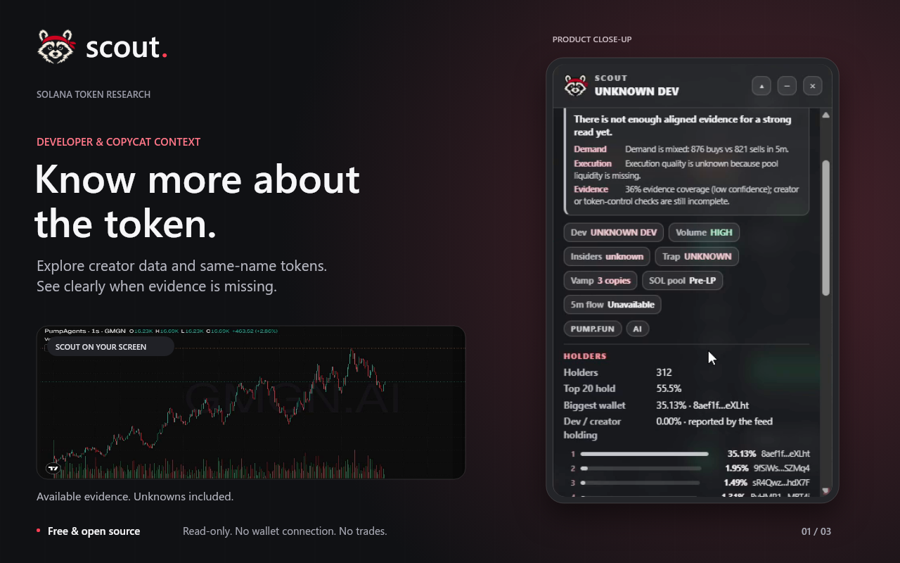
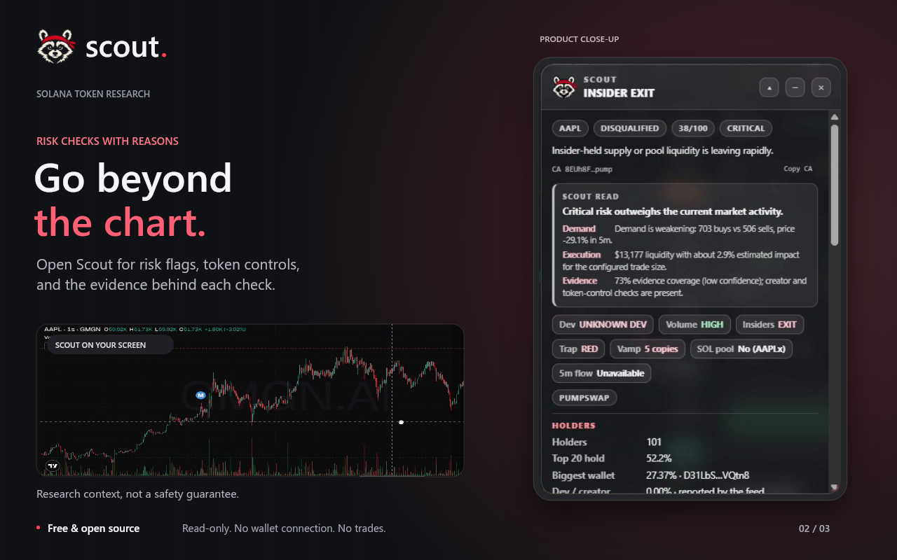
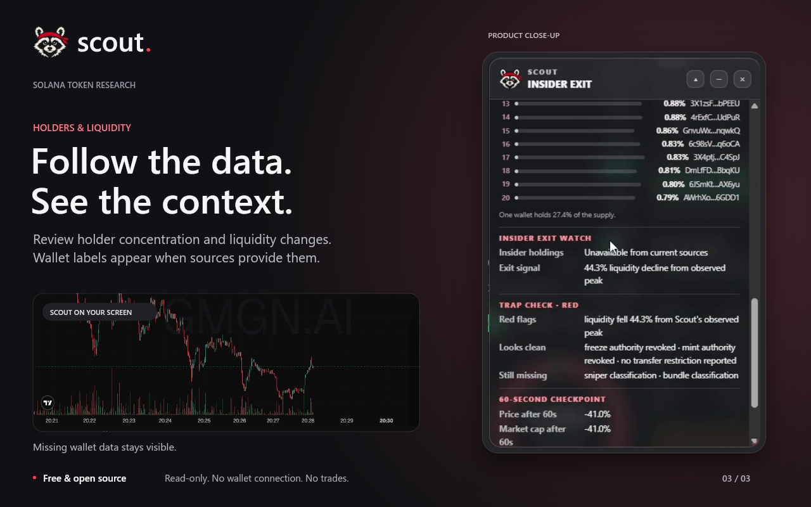
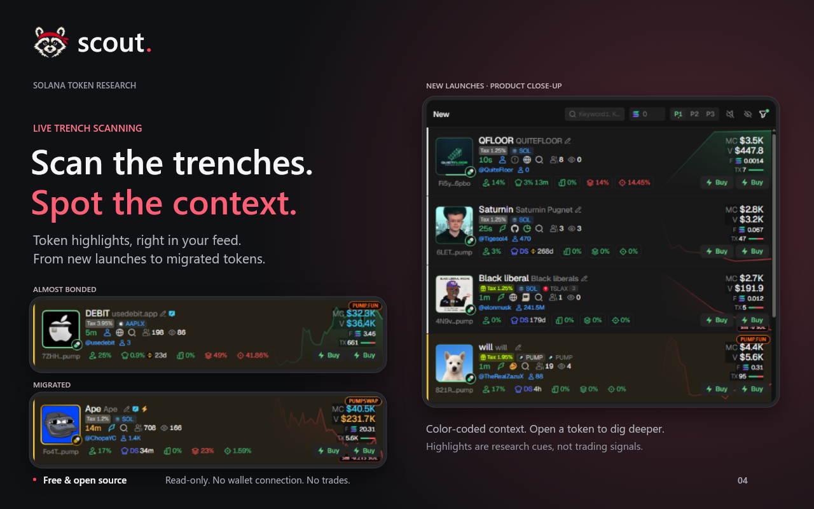

# Scout

<p align="center">
  <a href="https://scoutai.trade/">
    
  </a>
</p>

<p align="center">
  <strong>See more. Trade informed.</strong><br>
  Independent Solana token research inside Axiom, GMGN, and Padre.
</p>

<p align="center">
  <a href="https://chromewebstore.google.com/detail/mcmjonacgckbkemcmngpbpdhogagncak">Chrome Web Store</a>
  &nbsp;·&nbsp;
  <a href="https://scoutai.trade/">Website</a>
  &nbsp;·&nbsp;
  <a href="./PRIVACY.md">Privacy</a>
  &nbsp;·&nbsp;
  <a href="./SECURITY.md">Security</a>
</p>

Scout is a read-only Chromium extension for researching Solana meme coins. It matches tokens by their full mint address, adds clear risk and market context to the pages traders already use, and keeps missing evidence visible instead of guessing.

<p align="center">
  
  
</p>

<p align="center">
  
  
</p>

<p align="center">
</p>

## What Scout shows

- Holder count, top-holder concentration, and developer holdings
- Liquidity, volume, price movement, buys, and sells
- Token controls such as mint, freeze, and transfer authority
- Developer history and wallet-quality signals when sources publish them
- Same-name token and copycat context
- Compact highlights for quick scanning, with detailed evidence on hover or in the panel

Scout uses green, yellow, red, and neutral states to organize evidence. A neutral coin is not being marked safe. It means Scout does not have enough verified information to make a stronger classification.

## Built for the trading screen

Scout works directly on:

- [Axiom](https://axiom.trade/)
- [GMGN](https://gmgn.ai/)
- [Padre](https://trade.padre.gg/)

Panels can be moved and resized. Preferences, filters, and layout settings stay on the user's device.

## Safety by design

Scout does not connect to a wallet, request a seed phrase, sign transactions, place orders, or modify trading controls. It has no analytics or user accounts.

The extension requests public token information from DexScreener, GeckoTerminal, GoPlus, RugCheck, and GMGN. Requests contain the public Solana mint being researched, not wallet credentials or personal account data.

See [PRIVACY.md](./PRIVACY.md) for the complete data policy and [SECURITY.md](./SECURITY.md) for vulnerability reporting.

## Install from source

Requirements:

- Node.js 20 or newer
- npm
- Chrome, Brave, or another Chromium browser

```bash
npm install
npm test
```

Then open `chrome://extensions` or `brave://extensions`, enable Developer mode, choose **Load unpacked**, and select the generated `dist` folder.

## Development

```bash
npm run typecheck
npm run build
npm test
```

Create a store-ready archive with:

```bash
npm run pack
```

The version in `package.json` is the source of truth for release builds.

## How matching works

Scout identifies a token only when it can resolve a complete Solana mint from the page. Tickers and names are never used as identity because unrelated tokens can share them. If a mint is missing or ambiguous, Scout leaves the token unverified.

Market and security coverage varies for new launches. Missing values remain unknown rather than being replaced with zero or inferred data. Scout is a research interface, not financial advice or a trading signal.

## Project structure

- `src/` contains the extension source
- `tests/` contains the test suite
- `site/` contains the public website
- `store/` contains Chrome Web Store artwork
- `scripts/` contains build and release tooling

## Contributing

Issues and focused pull requests are welcome. Please include the affected site, a reproducible token page or mint when appropriate, and the Scout version you tested.

Do not post private keys, seed phrases, account credentials, or sensitive wallet information in an issue.

## Licence

The source code is available under the [MIT License](./LICENSE), copyright Brightside.

The Scout name, logo, and mascot are not granted under the MIT licence and may be protected by trademark rights. Third-party data remains governed by its providers, including DexScreener and the other public data services Scout uses.

Scout is independent software and is not affiliated with or endorsed by Axiom, GMGN, Padre, Solana, or any data provider.
